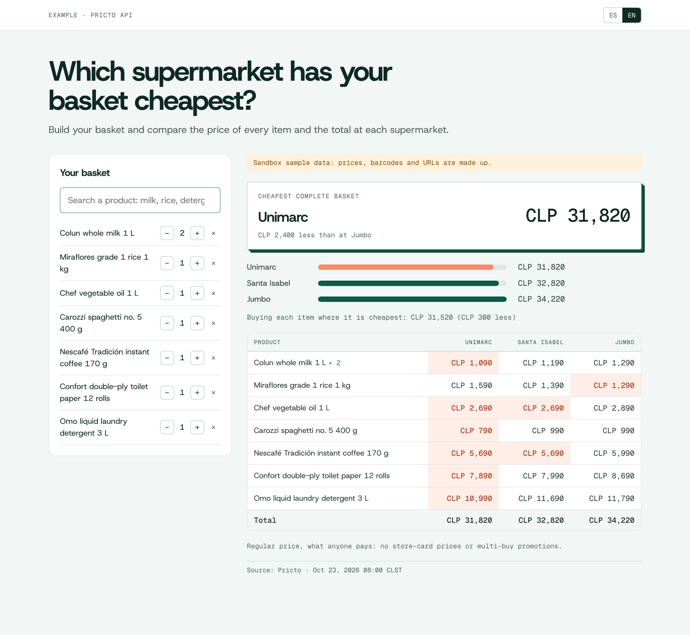

# supermarket-comparator

English · [Español](README.md)

Build a basket and see which Chilean supermarket has it cheapest, with the [Pricto](https://pricto.dev) API: the price of every item at every store, the total per store and what it costs if you buy each item where it is cheapest. One static page and two TypeScript functions, no production dependencies.

[](https://vercel.com/new/clone?repository-url=https%3A%2F%2Fgithub.com%2FPricto%2Fsupermarket-comparator)



## Run it locally

Needs Node 22 or later. No account needed: without `PRICTO_API_KEY` it uses the public sandbox (`sk_test_sandbox`), which answers with sample data.

```bash
git clone https://github.com/Pricto/supermarket-comparator && cd supermarket-comparator
npm install && npm start      # http://localhost:3000
```

On first load it builds a starter basket (milk, rice, oil, pasta, coffee, toilet paper and detergent) by searching for each item by text, so it works the same with the sandbox and with real data. The basket is kept in the browser.

## Deploy to Vercel

The button above clones the repo into your account and deploys it. It works with no settings (on the sandbox); for real data, add `PRICTO_API_KEY` under Project → Settings → Environment Variables and redeploy.

| Variable | What for | Default |
|---|---|---|
| `PRICTO_API_KEY` | Your API key. It stays on the server: the browser never sees it. | `sk_test_sandbox` (sample data) |
| `PRICTO_API_URL` | Another API instance | `https://pricto.dev` |
| `PORT` | Local server port | `3000` |

## How it works

```
public/          index.html, app.js and style.css: the UI, in Spanish and English
api/search.ts    GET  /api/search?q=   → GET  /v1/products/search
api/compare.ts   POST /api/compare     → GET  /v1/retailers?segment=supermarket
                                          POST /v1/prices/compare  (only those supermarkets)
lib/api.ts       adds the key, retries 429s per Retry-After and passes errors through as they are
server.ts        local server with the same handlers Vercel runs in api/
```

`POST /v1/prices/compare` does most of the work: it returns the price of each item at each store and the total per store, complete baskets first and the cheapest on top. The page only computes the split basket (each item where it is cheapest) and highlights the lowest price in every row.

Prices are `price`, what anyone pays. The API also returns the store-card price (`card_price`, which `compare` can total with `price_type: "card_price"`) and multi-buy promotions; this example doesn't use them.

What it costs with a real key: 1 credit per price in the matrix (item × store with data) and 1 per search; repeating the same query within 24 hours is free. Every response reports the charge in `meta.credits_charged`.

## Tests

They run against the public sandbox:

```bash
npm test
npm run typecheck
```

`PRICTO_API_URL=http://localhost:8787 npm test` runs them against a local instance.

## License

Code under [MIT](LICENSE). The Host Grotesk and Geist Mono fonts are included under the [SIL Open Font License 1.1](public/fonts/OFL.txt).
