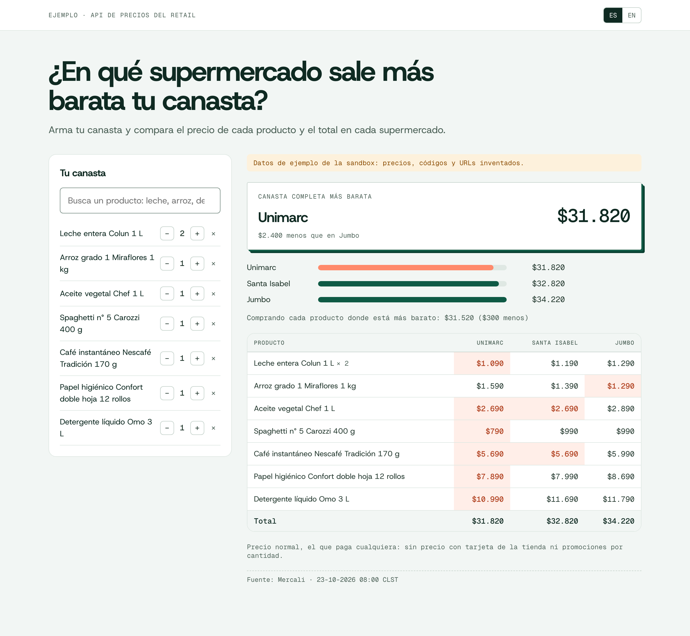

# supermarket-comparator

[English](README.en.md) · Español

Arma una canasta y mira en qué supermercado de Chile sale más barata: el precio de cada producto en cada tienda, el total por tienda y cuánto cuesta si compras cada producto donde está más barato. Una página estática y dos funciones en TypeScript, sin dependencias en producción.

[](https://vercel.com/new/clone?repository-url=https%3A%2F%2Fgithub.com%2FMarceloFarrMintii%2Fsupermarket-comparator)



## Pruébalo en local

Requiere Node 22 o superior. No necesitas cuenta: sin `PRICES_API_KEY`, usa la sandbox pública (`sk_test_sandbox`), que responde con datos de ejemplo.

```bash
git clone https://github.com/MarceloFarrMintii/supermarket-comparator && cd supermarket-comparator
npm install && npm start      # http://localhost:3000
```

La primera vez arma una canasta de ejemplo (leche, arroz, aceite, fideos, café, papel higiénico y detergente) buscándola por texto, así que funciona igual con la sandbox y con datos reales. La canasta se guarda en el navegador.

## Despliégalo en Vercel

El botón de arriba clona el repo en tu cuenta y lo despliega. Funciona sin configurar nada (con la sandbox); para datos reales, agrega `PRICES_API_KEY` en Project → Settings → Environment Variables y vuelve a desplegar.

| Variable | Para qué | Por omisión |
|---|---|---|
| `PRICES_API_KEY` | Tu API key. Vive solo en el servidor: el navegador nunca la ve. | `sk_test_sandbox` (datos de ejemplo) |
| `PRICES_API_URL` | Otra instancia de la API | `https://mercali-platform.vercel.app` |
| `PORT` | Puerto del servidor local | `3000` |

## Cómo funciona

```
public/          index.html, app.js y style.css: la interfaz, en español e inglés
api/search.ts    GET  /api/search?q=   → GET  /v1/products/search
api/compare.ts   POST /api/compare     → GET  /v1/retailers?segment=supermarket
                                          POST /v1/prices/compare  (solo esos supermercados)
lib/api.ts       agrega la key, reintenta los 429 según Retry-After y devuelve los errores tal cual
server.ts        servidor local con los mismos handlers que Vercel corre en api/
```

`POST /v1/prices/compare` hace casi todo el trabajo: devuelve el precio de cada producto en cada tienda y el total por tienda, con las canastas completas primero y la más barata arriba. La página solo calcula la compra dividida (cada producto donde está más barato) y destaca el mínimo de cada fila.

Los precios son `price`, lo que paga cualquier persona. La API trae aparte el precio con tarjeta de la tienda (`card_price`, que `compare` puede totalizar con `price_type: "card_price"`) y las promociones por cantidad; este ejemplo no las usa.

Cuánto cuesta con una key real: 1 crédito por cada precio de la matriz (producto × tienda con dato) y 1 por cada búsqueda; repetir la misma consulta dentro de 24 horas es gratis. Cada respuesta informa lo cobrado en `meta.credits_charged`.

## Tests

Corren contra la sandbox pública:

```bash
npm test
npm run typecheck
```

`PRICES_API_URL=http://localhost:8787 npm test` los corre contra una instancia local.

## Licencia

Código bajo [MIT](LICENSE). Las fuentes Host Grotesk y Geist Mono van incluidas bajo la [SIL Open Font License 1.1](public/fonts/OFL.txt).
